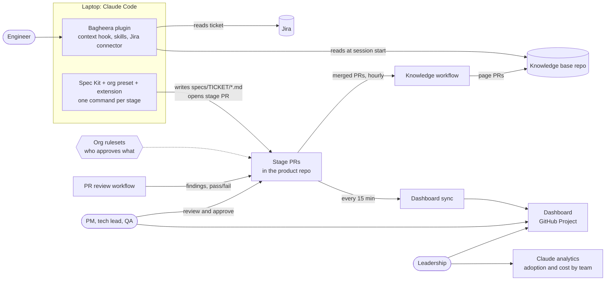

# Bagheera — Lean architecture

_Status: draft, updated 2026-10-26 with the owner's decisions · Source of truth: [prd.md](prd.md)_

> **Read with the decisions.** The owner's decisions of 2026-10-26 ([decisions/](decisions/)) change some parts below: approval is an `/approved` comment rather than ruleset approvals, Spec Kit is likely carried in the plugin, commands use the PRD's stage names, and the knowledge library is more cautious. The [design docs](design/README.md) work out each area in detail and replace this page's detail where they differ.

## Summary

Bagheera is two GitHub repos plus configuration of existing tools. One Claude Code plugin, installed for everyone through managed settings, loads the org's knowledge and standards into every session. Each product repo uses GitHub Spec Kit with our preset and extension, so every feature follows the same stage commands. Each stage writes a markdown file to `specs/<TICKET>/` and opens a pull request; the stage is approved when that PR merges with the right person's approval, which GitHub rulesets enforce. In CI, claude-code-action reviews every PR and updates the knowledge base from merged work, and a sync job keeps a GitHub Project dashboard current. The only code written from scratch is one small helper script. Where a decision is open, this draft shows the option I'd put first, marked _(Decision n)_.



**A feature's path** (command names depend on Decision 4). Each step opens a PR for the named approver.

1. `/speckit-specify PAY-412`: `spec.md` from the ticket, with open questions → PM
2. `/speckit-plan`: architecture, `plan.md` → tech lead
3. `/speckit-tasks`: 2–6 phases, `tasks.md` → tech lead and PM
4. `/speckit-bagheera-test-plan`: criteria and cases, `test-plan.md` → PM and QA
5. `/speckit-implement`: one phase, tests first → code review
6. CI reviews every PR against the standards
7. `/speckit-bagheera-demo`: `demo.md` → PM
8. After the last merge, the knowledge workflow writes the feature entry

At any time, `/speckit-bagheera-status` or a new session says where the feature stands and what's next.

## Moving parts

Each part is here because a must-have fails without it (next table). Only the helper script is written from scratch; the rest is configuration or content (templates, prompts, workflow files).

| Part | What it does | Goals | Built on, or why built |
| --- | --- | --- | --- |
| **`seeonee/bagheera` repo** | Everything Bagheera ships: plugin, marketplace file, preset, extension, workflows, settings, guide | all | GitHub |
| **Knowledge base repo** | Standards, service pages, decisions, feature entries, index, change log | G1, G2 | git; front matter shaped like the Open Knowledge Format |
| **Managed settings** | Force-install the plugin; allow only our marketplace; deny forbidden actions | G2, G3 | Claude Code managed settings (Decision 1) |
| **Plugin: session-start hook** | Refresh the local knowledge base copy; load the repo's service page, its standards and "what's next" | G1–G3 | `SessionStart` hook. CLAUDE.md imports can't pick the page per repo |
| **Plugin: skills** | `standards-review` (local and CI); `knowledge` (search pages, record lessons) | G1, G2 | Claude Code skills |
| **Plugin: Jira connector** | Read the ticket and linked pages at intake | G3, G4 | Atlassian Rovo MCP server |
| **Helper script** | `context`, `status`, `gate`, `kb-check`, `dashboard-sync` | G1–G5 | **Built:** Spec Kit's status can't see GitHub approvals; Projects automations only react to merge or close |
| **Spec Kit + org preset** | Our templates and command changes for stages 1–3 and 5 | G2–G4 | Spec Kit 1.2 preset |
| **Org extension** | Test plan, demo and status commands | G3, G4 | Spec Kit extension; community ones are unreviewed code for laptops |
| **Org rulesets** | Which team approves which `specs/` file; branch protection; review required | G2, G4 | GitHub rulesets, required-reviewer rule (Decision 3) |
| **PR review workflow** | Standards and security review on every PR | G2 | claude-code-action |
| **Knowledge workflow** | Hourly page updates from merged PRs; checks on KB PRs; weekly health report | G1 | claude-code-action; lychee |
| **Dashboard sync workflow** | Write each story's status every 15 min; weekly summary | G4, G5 | GitHub Actions |
| **Dashboard** | Story list, filters, "waiting on me" | G4, G5 | GitHub Projects (Decision 6) |
| **Analytics + CI workspace** | Adoption and cost by team; CI spend limit; short-lived CI credentials | G5 | Claude analytics; Console workspace; workload identity |
| **Seeding** (one-off) | First draft of each service page | G1 | DeepWiki-Open or the knowledge agent (Decision 10) |

**Left out:** a guard hook (deny rules and rulesets meet R4), an OpenTelemetry stack (built-in analytics cover V6), a session-digest queue (lessons travel with the feature's PR), per-repo workflow files, Anthropic's managed Code Review (can't read the knowledge base, never blocks).

## Must-haves and what meets them

| ID | Met by | Flags |
| --- | --- | --- |
| K1, K2 | Knowledge base repo; schema checked by `kb-check` | |
| K3 | Knowledge workflow, hourly | A sweep, not per merge: org-required workflows can't fire on merge. Meets "within a day". |
| K4 | KB rulesets: owners approve standards and decisions; the rest auto-merges | **Test early:** "no general approval plus owner review". |
| K5 | Edit-only agent, path allowlist, tool-less injection screen | **Costly, and no guarantee** (Decision 9). |
| K6 | Knowledge workflow, weekly | Contradictions are best effort. |
| K7, R2 | Session-start hook | |
| K8 | Seeding | Decision 10. |
| R1 | Knowledge base repo; rulesets name the owners | |
| R3 | PR review workflow, required by rulesets | PRs open as drafts, so review lands before people are asked. |
| R4 | Managed deny rules; rulesets block force-push | Red-team the deny rules in the pilot. |
| P1 | Preset; Jira connector | **Needs Jira Cloud**; uses Atlassian Rovo credits. |
| P2, P3, P5 | Preset; extension; `gate`; session-start hook | |
| P4, D1 | Managed settings; plugin; Spec Kit per repo | Decision 5. |
| P6 | One-page guide | **Conflict:** Spec Kit's `plan`/`tasks` are the PRD's Architecture/Plan (Decision 4). |
| P7 | CI workflows load the same plugin | |
| C1, C5 | PRs render markdown and Mermaid; rulesets request the PM team; "waiting on me" view | **Needs Q2:** GitHub accounts. |
| C2 | Numbered open questions; PM answers in the PR | |
| C3 | Approved = merged with the team's approval; `gate` checks the local copy matches main | Approving teams need write access. |
| C4 | IDs like `AC-PAY412-03` used as test names; demo lists pass/fail | |
| V1–V4 | Dashboard; sync workflow | **Needs Q2** for every viewer. |
| V6 | Claude analytics | **Costly unless Enterprise:** only its API groups by team. |
| D2 | Security owns hooks, scripts and settings in the bagheera repo | |
| D3 | Workload identity federation; one-hour GitHub App tokens | **Needs Anthropic API.** The App key is an org secret. |
| D4 | `--max-budget-usd`, `--max-turns`, job timeouts; CI workspace limit | |

Nothing is unmet. **Risks:** spec-only merges may trigger existing deploys (add a `specs/**` path filter); every PM, QA and leader needs a GitHub seat. **Assumptions:** GitHub underpins approvals, CI and the dashboard; Jira only intake; the Anthropic API only CI sign-in, CI cost and team analytics.

## Dashboard (V1–V4)

An org-level GitHub Project _(Decision 6)_: nothing new to run, and PMs are already in GitHub to approve. One row per story; the title opens the PR waiting for approval. View-only (Q3).

```text
Stories              [Waiting on me]  All  By team  Stuck > 2 days  Shipped
Filter:  team ▾   PM ▾   stage ▾   status ▾

Story (opens PR to approve)            Repo          Stage         Status                Waiting on          For      Phases
PAY-412 Retry failed payments · Tests  payments-api  4 Test plan   Waiting for approval  PM @asha, QA @lin   2 days   – / 3
PAY-398 Refund webhooks · Phase 2      payments-api  5 Build       In code review        @tomas (reviewer)   5 hours  1 / 4
SRCH-77 Typo-tolerant search · Spec    search-svc    1 Spec        Changes requested     @kim (developer)    1 day    –
PAY-350 Saved cards · Demo             payments-web  7 Demo        Waiting for approval  PM @asha            4 days ⚠ 3 / 3
```

**Where status comes from (V4):** only repos and PRs; nobody types it.

* **Story:** a `specs/<TICKET>/` folder in an onboarded repo. **Stage:** the latest artifact present: `spec.md` is stage 1, `plan.md` 2, `tasks.md` 3, `test-plan.md` 4, phase PRs 5–6, `demo.md` 7, the knowledge base's feature entry 8.
* **Status and waiting on:** the open stage PR's missing team approvals, or the developer if changes are requested, checks fail or it's a draft. The sync makes them the PR's assignees, so "waiting on me" is `assignee:@me`.
* **For:** time in this state. **Phases:** merged phase PRs over phases in `tasks.md`.

Adoption and cost (V6) stay in Claude's analytics, joined to the stories only in the weekly summary. A generated page (Decision 6) would put them in one place, at the cost of building it.

## Decisions

| # | Decision | Outcome | Record |
| --- | --- | --- | --- |
| 1 | Claude plan and model access (Q7, Q8) | Open: set by the organisation; the owner will update. The design keeps both paths. | — |
| 2 | GitHub access for PMs, QA and leadership (Q2) | Yes | [0001](decisions/0001-github-access-for-pms-qa-and-leadership.md) |
| 3 | What counts as approval (C3) | An `/approved` comment by the designated role, enforced by process | [0002](decisions/0002-soft-approval-by-comment.md) |
| 4 | Stage and command names (P6) | The PRD's stage names, with a light Jungle Book touch | [0003](decisions/0003-stage-names-from-the-prd.md) |
| 5 | How Spec Kit reaches each repo (P4, D1) | Leaning: carried in the plugin; confirm in design doc 3 | [0004](decisions/0004-carry-spec-kit-in-the-plugin.md) (proposed) |
| 6 | Dashboard (V1–V4, Q3) | View-only, with links; data source to brainstorm | [0005](decisions/0005-view-only-dashboard.md) |
| 7 | Jira (Q6, V5) | Link only | [0006](decisions/0006-jira-link-only.md) |
| 8 | One knowledge base or one per domain (Q5) | One master library; hierarchy later if needed | [0007](decisions/0007-one-knowledge-library.md) |
| 9 | Knowledge auto-merge and injection risk (K4, K5) | Cautious; track provenance; never trust external documents blindly | [0008](decisions/0008-caution-and-provenance-for-the-knowledge-library.md) |
| 10 | Seeding (K8) | DeepWiki-Open, run locally by the owner | [0009](decisions/0009-seed-service-pages-with-deepwiki-open.md) |
| 11 | Names (Q1, theme) | Indicative names; Jungle Book names for individual components; org still `seeonee` | [0010](decisions/0010-naming.md) |
| 12 | Pilot team, feature and preview environments (Q9, Q4) | Demos run on the stage environment; pilot team still to choose | [0011](decisions/0011-stage-environment-for-demos.md) |
