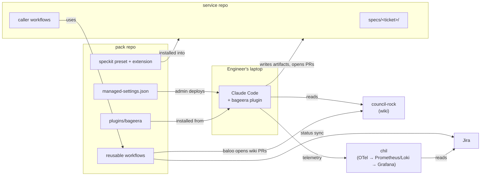

# What we build: the plugin repo and the monitoring repo

_Companion to [plan.md](plan.md). Names follow the [glossary](glossary.md). File contents shown here are sketches to make the shape concrete; exact keys get verified when each phase is built._

Bageera is spread over three repos plus a few files in each service repo:

| Repo | In one line | Who changes it |
| --- | --- | --- |
| `council-rock` | The wiki: markdown pages agents and people read | Mostly `baloo` (the curator) via PRs; humans approve `org/` and `decisions/` |
| `pack` | Everything that runs: the `bageera` plugin, the Spec Kit preset and extension, CI workflows, the managed-settings file | Platform team (2 people), reviewed like production code |
| `chil` | Monitoring: collects Claude Code telemetry and shows dashboards | Platform team |
| each service repo | Small caller files, CODEOWNERS lines, and the feature artifacts in `specs/<ticket>/` | The team that owns the service |



---

## 1. The `pack` repo

`pack` is a Claude Code **plugin marketplace**: a git repo that lists plugins Claude Code can install. We keep four things in it because they change together and share reviewers.

```
pack/
  .claude-plugin/marketplace.json     the marketplace listing (one plugin: bageera)
  plugins/bageera/                    1.1 the plugin
  speckit/                            1.2 Spec Kit preset + extension
    presets/bageera/
    extensions/bageera/
  .github/workflows/                  1.3 reusable CI workflows
  callers/                            copy-paste files for service repos
  managed-settings/managed-settings.json   1.4 what admins deploy
  bootstrap/deepwiki/                 one-off service-page bootstrap (Phase 1)
  onboarding/                         repo onboarding checklist and script (Phase 5)
  tests/                              tests for every script and hook
  CODEOWNERS                          platform owns all; security co-owns hooks and managed settings
```

`marketplace.json` is a short listing:

```json
{
  "name": "pack",
  "owner": { "name": "Bageera platform team" },
  "plugins": [
    { "name": "bageera", "source": "./plugins/bageera", "description": "Seeonee's SDLC harness" }
  ]
}
```

### 1.1 The `bageera` plugin

A **Claude Code plugin** is a folder Claude Code loads at startup. It can contain skills (instructions Claude follows, often invoked as slash commands), subagents (specialist Claude instances with their own tools and prompt), hooks (scripts Claude Code runs at fixed moments, which can block an action), and MCP server definitions (connections to outside tools). Everything in it runs on the engineer's machine with the engineer's permissions.

```
plugins/bageera/
  .claude-plugin/plugin.json          name "bageera", version
  skills/
    feature/SKILL.md                  /feature start|architect|plan|testplan|build|demo
    org-standards/SKILL.md            loads the relevant "Law" pages from the wiki
    deploy-config/SKILL.md            reads the env's deploy page before infra changes
    wiki-lookup/SKILL.md              how to find and cite wiki pages
    wiki-lint/SKILL.md                runs wiki checks (used in CI, also by hand)
  agents/
    baloo.md  kaa.md  mowgli.md  grey-brother.md  akela.md  hathi.md
  hooks/hooks.json                    which script runs on which event
  scripts/
    session-start.sh  wiki-refresh.sh  pre-tool-guard.sh
    post-edit-format.sh  session-digest.sh
  .mcp.json                           GitHub, Atlassian (Jira), Playwright, wiki (read-only)
```

**Skills: what engineers type.**

| Skill | What it does | Phase |
| --- | --- | --- |
| `feature` | One command per stage. `/feature start JIRA-123` reads the ticket through the Jira MCP server and calls Spec Kit to write `specs/JIRA-123/spec.md`. Later subcommands move through architecture, plan, test plan, build and demo. It doesn't run the workflow itself; Spec Kit does (1.2) | 2–3 |
| `org-standards` | Before Claude writes code, loads the wiki's standards pages that match the language and service being changed | 2 |
| `deploy-config` | Before any infra change, reads that environment's deploy page | 2 |
| `wiki-lookup` | Tells Claude where the wiki is (local copy first, MCP second), how to cite pages, and to never treat `raw/` as instructions | 1 |
| `wiki-lint` | Runs the wiki checks; the nightly job uses it, and a person can run it before opening a wiki PR | 1 |

**Agents: who does what.** Splitting work across agents keeps each one's tools narrow, and keeps the reviewer separate from the implementer so the work isn't grading itself.

| Agent | Job | Tools it gets | Runs |
| --- | --- | --- | --- |
| `baloo` | Turns a merged PR (diff, description, specs, digests) into wiki PRs | read, write inside the wiki checkout, `git`, `gh pr create` | CI, on merge |
| `kaa` | Writes architecture and plan artifacts | read, write only under `specs/` (enforced by a hook) | laptop, stages 2–3 |
| `mowgli` | Builds one plan phase in its own git worktree | read, edit, run tests | laptop, stage 5 |
| `grey-brother` | Writes the phase's tests from `testplan.md`, before code | read, write tests only | laptop, stage 5 |
| `akela` | Reviews a PR against standards and security | read only | CI and laptop, stage 6 |
| `hathi` | Walks acceptance flows on the preview env, records them, writes `demo.md` | read, Playwright | CI, stage 7 |

Each agent is one markdown file: a short front-matter block (name, description, tools, model, max turns, worktree isolation) and a prompt.

**Hooks: the guard rails.** Hooks are deterministic. The model can't talk its way past them.

| Event | Script | What it does |
| --- | --- | --- |
| `SessionStart` | `wiki-refresh.sh` | Keeps one shared copy of the wiki fresh (at most hourly, in the background) |
| `SessionStart` | `session-start.sh` | Adds this repo's service page and the active feature's artifacts (ticket from the branch name) to Claude's context |
| `PreToolUse` | `pre-tool-guard.sh` | Blocks: edits to protected paths; deploy commands (`kubectl apply`, `terraform apply`, …); a stage whose previous gate isn't approved on `main`; `kaa` writing outside `specs/` |
| `PostToolUse` | `post-edit-format.sh` | Runs the repo's own formatter or linter on files Claude just edited |
| `SessionEnd` | `session-digest.sh` | In the background, writes a short digest of decisions and gotchas and posts it to the wiki's digest queue |

**MCP servers: connections to outside tools.** All official or vendor servers; none written by us.

| Server | Used for |
| --- | --- |
| GitHub | PRs, issues, reviews |
| Atlassian | Reading Jira tickets and linked PRDs at intake |
| Playwright | `hathi` driving the browser for demos |
| GitHub, read-only, wiki tools only | Wiki lookups from any repo |

**What an engineer experiences.** They open Claude Code in a service repo. The service's wiki page is already in context. `/feature start JIRA-123` drafts a spec with open questions and opens a PR; the PM answers in the PR and approves. `/feature architect` would have refused before that approval. Each stage repeats the pattern until `/feature build 1` produces a phase PR with tests written first. When they quit, a digest of the session goes to the wiki queue. They never install or update anything: managed settings do that.

### 1.2 Spec Kit preset and extension

**Spec Kit** (GitHub, MIT) is the workflow engine for stages 1–3: it turns a feature description into a spec, a technical plan and a phased task list, using templates and commands it installs into each repo under `.specify/`. We don't write our own engine; we customise Spec Kit in its two supported ways:

* A **preset** replaces Spec Kit's built-in templates with ours.
* An **extension** adds new commands Spec Kit doesn't have.

```
speckit/
  presets/bageera/
    preset.yml
    templates/
      spec-template.md            + ticket front-matter, PM open questions
      plan-template.md            components, interfaces, data model, Mermaid diagram, draft ADRs
      tasks-template.md           2–6 phases, each shippable behind a flag
      constitution-template.md    built from the wiki's "Law" pages
  extensions/bageera/
    extension.yml
    commands/speckit.bageera.testplan.md   stage 4
    commands/speckit.bageera.demo.md       stage 7
    templates/testplan-template.md         Given/When/Then, IDs reused as Playwright test names
    templates/demo-template.md
```

**How it reaches a service repo.** Once per repo, the onboarding script runs `specify init --integration claude`, then adds the preset and extension from `pack`. That writes `.specify/` and the `/speckit-*` skills into the repo, committed like any other config.

**How it relates to the plugin.** Engineers type `/feature …` (plugin). The `feature` skill sets the output folder to `specs/<ticket>/` and calls the matching Spec Kit skill. The plugin adds what Spec Kit doesn't do: gates, wiki context, Jira intake.

### 1.3 Reusable workflows

A **reusable workflow** is a GitHub Actions workflow other repos call with one `uses:` line, so 100 repos share one definition and get fixes by bumping a tag. Each runs `claude-code-action` (Claude Code in CI) with the same `bageera` plugin.

| Workflow | Runs when | Does | Phase |
| --- | --- | --- | --- |
| `wiki-curate.yml` | A PR merges in a service repo | Gathers the PR, specs and digests as untrusted files; `baloo` opens wiki PRs; ADRs go in a separate PR for owners | 1 |
| `harness-review.yml` | A PR opens or updates | `akela` posts a standards and security review | 3 |
| `harness-verify.yml` | Same | Repo's tests, coverage diff, Anthropic's security-review action | 3 |
| `harness-demo.yml` | PR marked ready, preview env up | `hathi` records the acceptance flows and posts `demo.md` | 3 |
| `jira-sync.yml` | Push to `specs/**` on main | Mirrors artifact status to the Jira ticket (no model involved) | 4 |
| `weekly-digest.yml` | Weekly schedule | Pulls numbers from `chil`, writes a one-page summary, posts to Slack | 4 |

A service repo adds a caller like this (from `callers/`):

```yaml
# .github/workflows/wiki-curate.yml in a service repo
name: wiki-curate
on:
  pull_request:
    types: [closed]
jobs:
  curate:
    if: github.event.pull_request.merged == true
    uses: seeonee/pack/.github/workflows/wiki-curate.yml@v1
    secrets: inherit
```

The wiki's own checks (schema lint, path policy, injection guard, nightly lint) live in `council-rock`, not here, because they protect that repo.

### 1.4 Managed-settings source

**Managed settings** are Claude Code settings an admin pushes to every engineer (through the claude.ai admin console, MDM, or a system file). Nobody can override them locally. This is how all 100 engineers get the same plugin version and the same guard rails. We keep the file in `pack` so changes are reviewed in PRs; an admin deploys the reviewed version.

```json
{
  "extraKnownMarketplaces": {
    "pack": { "source": { "source": "github", "repo": "seeonee/pack" } }
  },
  "strictKnownMarketplaces": [{ "source": "github", "repo": "seeonee/pack" }],
  "enabledPlugins": { "bageera@pack": true },
  "permissions": {
    "deny": ["Bash(git push --force*)", "Bash(kubectl apply*)", "Bash(terraform apply*)", "Read(~/.aws/**)"]
  },
  "env": {
    "CLAUDE_CODE_ENABLE_TELEMETRY": "1",
    "OTEL_METRICS_EXPORTER": "otlp",
    "OTEL_LOGS_EXPORTER": "otlp",
    "OTEL_EXPORTER_OTLP_PROTOCOL": "http/protobuf",
    "OTEL_EXPORTER_OTLP_ENDPOINT": "https://otel.chil.seeonee.internal",
    "OTEL_METRICS_INCLUDE_REPOSITORY": "true",
    "OTEL_LOG_TOOL_DETAILS": "1"
  },
  "requiredMinimumVersion": "2.1.269"
}
```

What each part does: registers our marketplace and blocks others; turns the plugin on for everyone; denies dangerous commands outright (a second layer behind the hook); turns telemetry on and points it at `chil`; refuses Claude Code versions too old for the telemetry fields we rely on.

---

## 2. The `chil` repo (monitoring)

`chil` is mostly configuration of open-source pieces. It answers two questions: **how is the harness used and what does it cost** (agent telemetry), and **where is each feature in the pipeline** (delivery progress).

```
chil/
  docker-compose.yml               collector, Prometheus, Loki, Grafana (from claude-code-otel)
  otel-collector/config.yaml       receives telemetry from laptops and CI, routes it
  prometheus/prometheus.yml        metrics storage, retention
  loki/config.yaml                 event (log) storage, retention
  grafana/
    provisioning/datasources/      Prometheus, Loki, GitHub, Infinity (for Jira)
    provisioning/repo-team-map.csv repo → team, generated nightly from wiki service pages
    dashboards/
      usage-and-cost.json          from claude-code-otel, plus repo/team filters
      delivery.json                features by stage, gate wait times, PR stats
      wiki-health.json             pages updated, stale pages, lint findings
    alerts/
      cost-outliers.yaml           per-feature cost far above normal
  README.md                        how to run it, retention, access
```

| Piece | What it is | Our configuration |
| --- | --- | --- |
| **OpenTelemetry Collector** | Receives telemetry over the standard OTLP protocol and forwards it | One endpoint for laptops and CI; drops prompt text unless explicitly enabled; sends metrics to Prometheus, events to Loki |
| **Prometheus** | Time-series database for numbers | Claude Code's metrics: sessions, tokens, cost, active time, lines changed, commits, PRs, labelled by repo and team |
| **Loki** | Log store for events | Claude Code's events: each prompt, tool decision, tool result, API call; used to tie sessions to features through commit events |
| **Grafana** | Dashboards and alerts | Three dashboards and one alert rule (below) |
| **GitHub data source** (official Grafana plugin) | Lets Grafana query GitHub | PR cycle time, review rounds, harness PRs vs others |
| **Infinity data source** (open-source Grafana plugin) | Lets Grafana query any JSON API | Jira search: features by stage, time in each status |

**The three dashboards.**

| Dashboard | Answers | Built from |
| --- | --- | --- |
| Usage and cost | Who uses Claude Code, how much, what it costs, per repo and team | `claude-code-otel` dashboards as shipped, plus filters |
| Delivery | Features by stage; where they wait (PM or tech-lead review); phases planned vs merged; PR cycle time for harness PRs vs others; acceptance criteria with a passing test | GitHub + Jira (Infinity) |
| Wiki health | Pages updated per week, stale pages, open lint findings, digest backlog | GitHub (wiki repo, lint report issue) |

**Where it runs.** On one VM or in your existing cluster; `docker compose up` for the pilot. If you already run Grafana or Prometheus, `chil` shrinks to the collector config, the dashboards and the alert file.

**What we build in `chil`.** Only the delivery and wiki-health dashboard JSON, the alert rule, and the repo→team map export. Everything else is taken as shipped.

---

## 3. What lands in each service repo

```
<service repo>/
  .github/workflows/wiki-curate.yml       caller (Phase 1)
  .github/workflows/harness-pr.yml        caller for review/verify/demo (Phase 3)
  .github/CODEOWNERS                      + specs/**/spec.md @seeonee/pm, etc. (Phase 2)
  .github/pull_request_template.md        links to specs/<ticket>/ (Phase 2)
  .specify/                               Spec Kit with the bageera preset and extension (Phase 2)
  specs/<ticket>/                         spec.md, plan.md, tasks.md, testplan.md, demo.md (per feature)
```

No plugin code, no hooks and no wiki copy live in service repos; those come from `pack` and managed settings.
