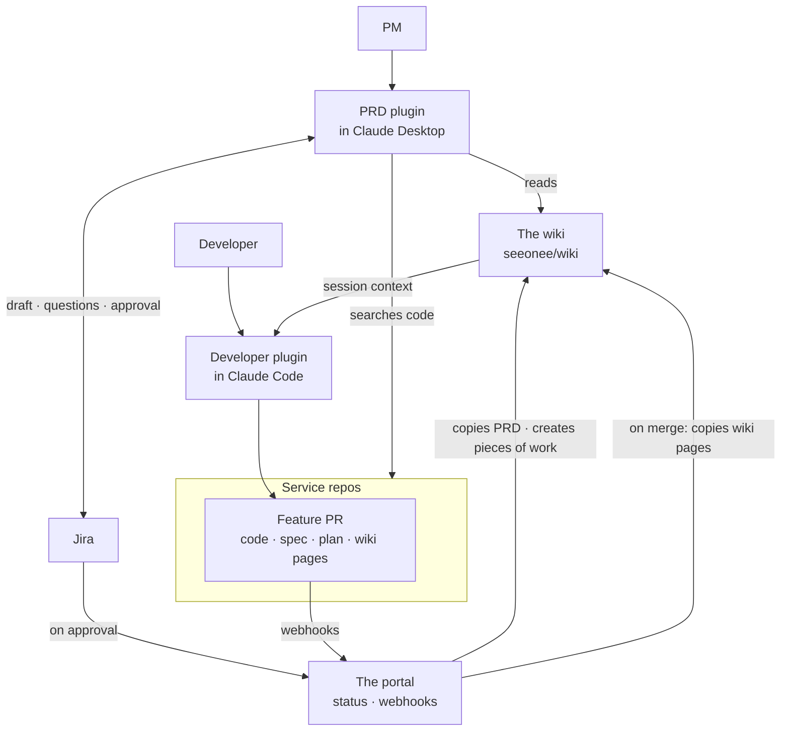

# Bagheera — Design (MVP)

_Status: draft for review · Owner: RN · 2026-11-17_

## 1. Overview

Four parts:

1. **The wiki**: one Git repo, `seeonee/wiki`, of typed Markdown pages (ADR 1).
2. **The PRD plugin**: a Claude Desktop plugin that helps PMs draft a PRD from the wiki and the code. The PRD lives in a Jira issue (ADR 4).
3. **The developer plugin**: a Claude Code plugin giving developers one path from an approved piece of work to a PR (ADR 5).
4. **The portal**: one web app where everyone sees where work stands, and which receives GitHub and Jira webhooks (ADR 6).



Nothing depends on CI. Both plugins come from the org's marketplace. PMs use the GitHub connector (read-only seat) and the Atlassian connector. Developers use their own `gh` login. The portal uses one GitHub App and a Jira token.

## 2. The wiki

### 2.1 Layout

```
wiki/
├── services/    # One page per service: owner, repo, what it depends on (ADR 2)
├── features/    # Shipped features: PRD, services changed, decisions, invariants
├── decisions/   # Product and technical decisions (MADR)
├── standards/   # Org rules with IDs; changed only by the council (ADR 7)
├── prds/        # Approved PRDs, copied from Jira by the portal
└── types/       # One file per page type: header fields, sections, word caps
```

### 2.2 Typed pages

Every page, including specs and plans in service repos, has a header that `types/` defines (K3). One check script, used by both plugins and the portal, validates headers, sections and word caps.

```yaml
---
type: service
id: payments-service
repo: seeonee/payments-service
owner_team: checkout
depends_on: [ledger-service, notification-service]
---
```

| Type | Key header fields | Word cap |
| --- | --- | --- |
| service | repo, owner_team, depends_on | 600 |
| feature | prd, services, decisions | 600 |
| decision | status, services | 400 |
| standard | owner: architecture-council; rule IDs as headings (`SEC-3`) | 1,500 |
| prd | pm, jira, services, teams | 1,000 |
| spec | work, prd, criteria | 500 |
| plan | work, spec, standards | 600 |

- **Links both ways (K2)**: pages store outgoing links only (`depends_on`, `services`, `prd`). What links to a page is found by searching headers.
- **How current (K8)**: a page shows the date of its last commit. When a page and the code disagree, the code wins and the next wiki change for that piece of work corrects the page.
- **Standards (S1, S2)**: each rule has its own ID and is short enough to check against a diff. The council owns `standards/` through CODEOWNERS.

### 2.3 Wiki changes from merged work (K5, K6, ADR 3)

1. At `ready-for-review`, the developer plugin writes the new versions of the affected pages under `.bagheera/<work-id>/wiki/`, mirroring wiki paths. The feature page is always one of them.
2. The reviewer reviews those pages with the code, in the same PR.
3. The portal posts a `bagheera/wiki` check on the PR. It fails if the pages are missing, fail the check script, or touch `standards/`. Teams make the check required.
4. On merge, the portal copies the pages to the wiki's default branch, with a commit linking the PR.

Text from tickets, documents and code is data (K7). The defence is that a person reviews every page before it reaches the wiki.

### 2.4 First pages for existing services (K10)

`/bagheera:draft-service-page`, run once in a service repo, reads the code and opens a PR in the wiki with that service's first page.

## 3. Drafting a PRD (PRD plugin, Claude Desktop)

### 3.1 Drafting

- **Start (R1)**: the PM describes an idea in plain words. The plugin creates the PRD's Jira issue, whose key is the PRD ID, and writes the draft into its description.
- **Help (R2, R3)**: Claude reads the wiki and searches the code through the GitHub connector, and reads the Jira and Confluence pages the PM names through the Atlassian connector. Every answer cites the wiki page or code it came from.
- **Checks (R4, R5)**: every claim about today's behaviour is checked against the wiki and the code. A conflict becomes an open question, with the evidence. Services, teams and standards touched come from following `depends_on`.
- **Saving (R8)**: each change updates the Jira issue's description, so the PM can pick up on any machine.
- **Copy out (R10)**: the PM copies the PRD into any tool, or into Confluence through the Atlassian connector.

### 3.2 PRD template (R7, B1)

| Section | Limit |
| --- | --- |
| Summary | 100 words |
| Problem | 150 words |
| Goals and non-goals | 150 words |
| How it works today, with citations | 200 words |
| Services, teams and standards touched | list |
| Requirements, each with its criteria `AC-n` in Given/When/Then | 300 words |
| Pieces of work: `W1`, `W2`…, each with its repo and criteria | list |
| Open questions: numbered, one line, one person each, at most 5 open | 5 |

### 3.3 Questions and approval (Jira)

- **Questions (R6, B3)**: each open question is a comment on the PRD's issue, @mentioning its person, who answers in Jira. Jira's own notification tells them. The plugin writes each answer into the PRD with their name.
- **Approval (A1, A2, A5)**: the PM tells Claude to approve, with a comment. The plugin posts `Approved: <comment>` on the issue, so Jira records who and when. Only the issue's reporter (its PM) can approve.
- **Changes (A4)**: a PRD counts as approved only if its latest approval is newer than its last description edit. Before approving again, the plugin shows the diff against the copy in the wiki.
- **Hand-off (R9)**: on the approval webhook, the portal copies the PRD to `prds/<key>.md` in the wiki, with the approver and comment in the commit. It also creates one Jira issue per piece of work, titled `<key>-W1` and so on, linked to the PRD's issue.

## 4. From a piece of work to a PR (developer plugin, Claude Code)

### 4.1 Steps

Each step is one command, and the work ID is `<prd-id>-W<n>`.

| Command | Does | Needs |
| --- | --- | --- |
| `/bagheera:start <work-id>` | Creates or checks out the branch `<work-id>`, drafts `.bagheera/<work-id>/spec.md` from the PRD, pushes, and opens a draft PR | Approved PRD |
| `/bagheera:plan` | Writes `plan.md`: files to change, contracts, the standards (by rule ID) that apply | Approved spec |
| `/bagheera:build` | Writes one test per criterion, named by its ID, then the code. Runs the tests and updates the criteria table in the PR description | Approved plan |
| `/bagheera:ready-for-review` | Writes the wiki pages (§2.3), runs the check script, and marks the PR ready for review | Criteria tests passing |
| `/bagheera:approve spec\|plan "<comment>"` | Posts an approval comment on the PR | — |

- **Push every step (P7)**: every command commits and pushes, so anyone can pick up the branch.
- **Redo (P6)**: running a step again redoes it. Redrafts keep finished work and criterion IDs, and the branch is reused, never recreated.
- **Starting in one action (P1)**: the portal shows each piece of work's `start` command to copy.

### 4.2 Approving specs and plans (A3–A5)

An approval is a PR comment naming the file and its content hash. It counts only if it was posted by the PR's author (the developer) or by the portal when a PM clicks Approve there. Editing the file changes its hash, which clears the approval. The pre-flight check reads these comments.

### 4.3 Pre-flight (P5)

Before every command, one script checks:

- this is the piece of work's repo, and `default_branch` comes from `.bagheera/config.yml` (it falls back to GitHub's default);
- the branch is the work's branch, clean, and up to date with the default branch;
- `gh` is signed in and the wiki clone pulls;
- the step's inputs exist and are approved.

It fixes what's safe (check out the branch, fast-forward, pull the wiki) and reports anything else in one line each, with the fix.

### 4.4 Context (K9, S3)

A SessionStart hook pulls the wiki into `~/.bagheera/wiki` and loads three things: this repo's service page, the pages linked to it, and the standards index (rule IDs with one line each). Claude follows links by reading the clone.

### 4.5 Blocks (S4)

A PreToolUse hook blocks, from one list in the developer plugin:

- force-push;
- deploy commands (`kubectl apply|delete`, `terraform apply`, `helm install|upgrade`);
- reading production credential files;
- edits to protected paths (`.github/workflows/`, `standards/`).

The list is matched by pattern, so a command written to get around it can slip through until S7 locks the blocks centrally.

## 5. Status (portal)

### 5.1 Derived from the work (V5)

| State | Comes from | Waiting on |
| --- | --- | --- |
| Drafting | PRD issue in Jira, not approved | PM, or whoever has an open question |
| PRD approved | PRD on the wiki's default branch | developer |
| Spec | `spec.md` on the branch, not approved | developer or PM |
| Plan | `plan.md`, not approved | developer or PM |
| Building | plan approved, PR in draft | developer |
| In review | PR ready for review | requested reviewers |
| Merged | PR merged | — |

"For how long" is the time since the last commit or comment. The portal reads GitHub and Jira when a page loads, with a short cache, and keeps no database.

### 5.2 Views

- **All work (V3)**: one list of PRD, piece of work, repo, state, who it's waiting on and since when. Filters: team, PM, "waiting on me".
- **One piece of work (V4)**: PRD, spec, plan, each criterion with its test result from the PR, and links to the PR.
- **Notices (V6)**: an email when something starts waiting on someone. Jira already notifies people of PRD questions, and GitHub notifies reviewers.

## 6. Security and setup

- **Sign-in (V1)**: the portal uses the org's OIDC sign-in. PMs use Claude Desktop, with a read-only GitHub seat and their Jira login.
- **Access (D2)**: one GitHub App, with read access to service repos, write access to the wiki, and PR comments and checks. Plus a Jira token. All keys are kept in the org's secret store. The council sets this up once.
- **Developers**: their own `gh` login and Claude Code sign-in.
- **Model provider (D3)**: Claude Code and Claude Desktop are set up through the org's settings: an Anthropic API key, `CLAUDE_CODE_USE_BEDROCK`, or `CLAUDE_CODE_USE_VERTEX`.
- **Bagheera's own changes (D1)**: reviewed like production code. CODEOWNERS makes security review the developer plugin's hooks and the portal.
