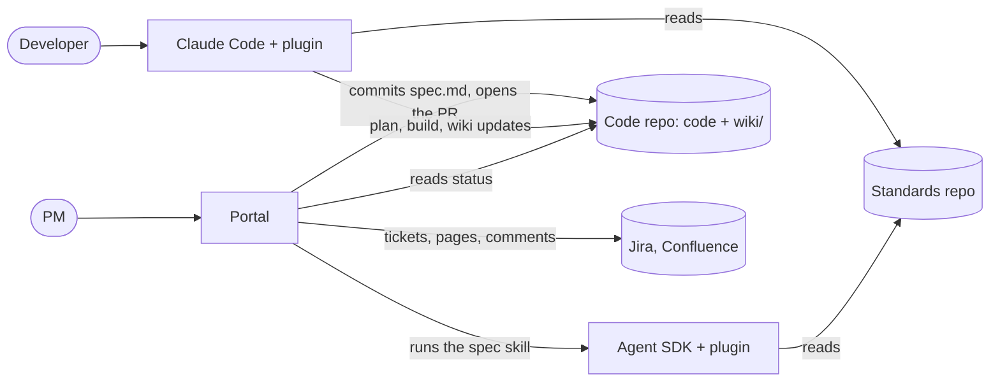

# Design

_The MVP · draft for review, 2026-11-14 · [PRD](prd.md) · [Plan](plan.md) · [Decisions](decisions/)_

## Parts

| Part | What it is |
| --- | --- |
| **The plugin**, `bagheera` | Commands `/bagheera`, `/bagheera:spec`, `/bagheera:plan`, `/bagheera:build`, `/bagheera:seed` and `/bagheera:standards`; the pre-flight, page-check and status scripts; page templates; the session-start hook; the Atlassian connector |
| **The portal** | One small web app with a board and a feature page. It runs the plugin's `spec` skill on the Claude Agent SDK |
| **Each repo's wiki** | `wiki/` beside the code: service and decision pages, and a folder per feature holding its spec and plan |
| **The standards repo** | `seeonee/standards`: the org's standards, owned by the architecture council |
| **The settings template** | Deny rules that each repo commits as `.claude/settings.json` |



## 1. A feature, end to end

Example: `PAY-412`, "Retry failed card payments", in `seeonee/payments-api`.

1. **Start.** The PM chooses *New feature* in the portal, enters `PAY-412` and picks `payments-api`.
2. **Draft.** The portal fetches the ticket and its linked Confluence pages, and the agent drafts the spec from those, the wikis and the code. The ticket assumes no retries today, but `charge_client.py` already retries twice, so that comes back as Q1, with the evidence.
3. **Converse.** The PM answers Q1 ("three in total"), asks how refunds interact with retries, and asks for a criterion to change. Each turn updates the spec and is committed. The first commit creates branch `PAY-412` and a draft PR.
4. **Approve.** Once no question for the PM is open, *Approve* becomes available. One click, and the portal commits the approval and mentions the developer on the Jira ticket.
5. **Plan.** The developer runs `/bagheera:plan`. Pre-flight switches to `PAY-412`, merges the default branch in and confirms the approval. The plan has three phases.
6. **Build.** The developer runs `/bagheera:build` once per phase: failing tests named after the criteria, then code. After the last phase, Build updates the service page, writes a decision page on retry limits, and marks the PR ready.
7. **Merge.** The tech lead reviews the code, plan and wiki changes together in GitHub. Once merged, the spec and plan are the feature's record in the wiki, and the board shows *Shipped*.

If the developer finds a gap mid-build, `/bagheera:spec` adds a question for the PM. That changes the spec, so its approval clears. The PM is told on the ticket, and approving the change again is one click.

## 2. Spec

Decided: [0001](decisions/0001-bagheera-starts-with-the-pms-requirements.md), [0004](decisions/0004-the-spec-is-checked-against-the-code-while-drafted.md), [0005](decisions/0005-one-approval-the-pm-approves-the-spec.md) (proposed).

### Drafting

* **Sources:** the ticket and the Confluence pages it links to (one level deep), the repo's wiki, the other onboarded repos' wikis, the standards index, and the repo's code on the ticket's branch.
* **Checked against the code.** Each statement about today's behaviour goes under *Today*, with the file it was checked in. If the code contradicts a statement, it becomes a question. It is never silently corrected.
* **Questions** are numbered across the feature (Q1, Q2…), each addressed to the approver or the developer. Only questions that block the spec are asked: at most 5 open at a time, one line each, the most blocking first. People answer them in the portal; developers can also answer with `/bagheera:spec`.
* **The spec file is the state.** The chat can be thrown away: a PM who comes back later carries on from the file.
* **In Claude Code,** `/bagheera:spec PAY-412` runs the same skill and reads the ticket through the Atlassian connector. Developers use it to raise questions, and to draft specs for tickets with no PM.

### Approval

* The approver named in the spec approves it, in the portal only. The portal commits the approval as its GitHub App, with an `Approved-by:` trailer.
* An approval counts only while the last commit to `spec.md` is that approval commit, which GitHub marks as verified. Any later change clears it, hand edits included.
* *Approve* is available only when no question for the approver is open. When approving again, the approver sees only what changed since their last approval.
* For a ticket with no PM, the spec names the developer or the tech lead as approver.

### The page

| Section | Limit |
| --- | --- |
| Header: `type: spec`, `title`, `updated`, `ticket`, `approver`, `developer`, `approved` (`{by, on}` or empty) | — |
| What and why | 3 sentences |
| Today: what the code does now that this relies on, each with its file | 5 lines |
| Acceptance criteria: `PAY-412-AC-1`… in Given/When/Then, one line each | 10 |
| Out of scope | 5 lines |
| Questions: number, for whom, the question; once answered, the answer and who gave it | 5 open |

Cap: 400 words, header excluded.

## 3. Plan

* Reads the approved spec, the wiki, the code and the standards that apply.
* Writes `wiki/features/PAY-412/plan.md`. The plan has no approval step; the tech lead can read it on the draft PR or in the portal at any time, and reviews it with the code.
* If the plan needs the spec to change, Plan stops and suggests `/bagheera:spec` to raise a question.

| Section | Limit |
| --- | --- |
| Header: `type: plan`, `title`, `updated`, `ticket` | — |
| Approach | 5 sentences |
| Changes: components, interfaces, data | 10 lines |
| Decisions: each one line, with why | 5 |
| Phases: 2–6, each a checkbox with the criteria it makes true; after Build, its tests and their results | — |

Cap: 500 words. Include a Mermaid diagram only if it saves words.

## 4. Build

Decided: [0012](decisions/0012-build-tests-first-one-phase-at-a-time.md).

* `/bagheera:build` builds the next phase, or carries on with the open one. Phases go one at a time, in order.
* **Tests first.** It writes tests for the phase's criteria, named with their IDs (`test_PAY_412_AC_3_…`), and checks that they fail for the right reason. They're committed on their own. Then it writes code until they and the repo's existing tests pass.
* **Tick off.** It ticks the phase in `plan.md`, lists each criterion's tests and result, then commits and pushes.
* **After the last phase,** it updates the service pages the change touched and writes a decision page for each plan decision that held. Then it runs the page check and marks the PR ready.
* **Build never changes the criteria.** A wrong criterion stops it, and the next step is `/bagheera:spec`.
* If review changes the behaviour, re-running Build refreshes the wiki pages it wrote.

## 5. Pre-flight

Decided: [0006](decisions/0006-a-pre-flight-check-before-every-stage.md).

One script, run first by every command, and by the portal before it drafts or commits. It fixes what's safe and stops on the rest. Each problem gets one line, with its fix; when all is clear, it prints one line.

| Check | Fixes | Stops when |
| --- | --- | --- |
| Repo | — | It's not a git repo with a GitHub remote |
| Default branch | Reads it from GitHub, never assuming `main` or `master` | GitHub can't be reached |
| Ticket's branch | Creates `PAY-412` from the default branch, or fetches it and switches to it | Switching would carry uncommitted changes |
| Up to date | Pulls the ticket's branch and merges the default branch in | There's a merge conflict; it lists the files |
| Sign-ins | — | `gh` isn't signed in, or the Atlassian connector isn't connected (Spec and Standards only) |
| Wiki | — | Never stops; warns once if the repo has no service page yet, suggesting `/bagheera:seed` |
| Inputs | — | Plan: no valid, approved spec. Build: also no valid plan |

```text
✗ spec.md isn't approved: waiting on Asha since Tue. Portal: <link>
```

## 6. Branches and re-running

Decided: [0011](decisions/0011-one-ticket-one-repo-one-branch-one-pr.md).

* **One ticket, one repo, one branch, one PR.** The branch is named after the ticket key and made from the default branch. Work spanning repos is one ticket per repo, linked in Jira.
* **The draft PR opens with the spec's first commit,** titled `PAY-412: <title>` and linking to the ticket.
* **Who writes what.** The portal writes only `spec.md`; the commands write everything else. Each command pulls before it pushes, and commits and pushes when it ends. Nothing lives only on a laptop, so handing a ticket over is just reassigning it in Jira.
* **The default branch comes in by merging,** never by rebasing or force-pushing.
* **Re-running.** Spec revises the spec, which clears its approval. Plan revises the plan, keeping ticked phases as built; new phases follow them. Build carries on. Criteria and question numbers are never reused.
* **After merge,** more work is a new ticket. **To abandon a ticket,** close its PR.

Accepted: Bagheera doesn't see work on any branch other than the ticket key.

## 7. The wiki

Decided: [0007](decisions/0007-every-document-is-a-typed-page-in-git.md), [0008](decisions/0008-each-repo-keeps-its-own-wiki.md) (proposed), [0009](decisions/0009-hard-limits-on-length.md).

```text
wiki/
  services/payments-api.md
  decisions/retry-limits.md
  features/PAY-412/spec.md
  features/PAY-412/plan.md
```

### Page types

Every page has a YAML header with `type`, `title` and `updated`, plus its type's own fields. Caps are in words, header excluded.

| Type | Own header fields | Sections | Cap |
| --- | --- | --- | --- |
| `service` | — | Purpose (2 sentences) · Interfaces · Depends on (one line each, with its repo) · Data · Gotchas (one line each) | 400 |
| `decision` | `kind` (`product` or `technical`), `ticket` | Context (60 words) · Decision (1 sentence) · Why (3 bullets) · Consequences (3 bullets) | 200 |
| `spec` | [Section 2](#the-page) | [Section 2](#the-page) | 400 |
| `plan` | [Section 3](#3-plan) | [Section 3](#3-plan) | 500 |
| `standard` | `prefix` | Numbered rules, one line each, with why and an example | 500 |

### Rules

* **The code wins.** A session that finds a page wrong fixes it in its own PR.
* **Rewrite in place.** When something changes, change the page; git keeps the history. A changed decision is an edited page.
* **Link, don't copy.** Reasoning, logs and discussion stay where they were written, and pages link to them. No logs, transcripts, or code longer than 10 lines.
* **Nothing two branches could both take.** Decisions are named by a slug, and criteria IDs include the ticket.
* **No index file.** The session-start hook and the portal build the index from page headers when they read the wiki, so branches never conflict over it.

### The page check

One script in the plugin, also used by the portal. Bagheera runs it before every commit it makes. It fails a page on:

* header fields that are missing or unknown
* sections that are missing, empty or extra
* a section over its limit, or a page over its cap
* logs, or code over 10 lines
* links that don't resolve, or duplicate criteria IDs
* in standards, a rule line without an ID, a prefix another standard uses, or a rule ID that has disappeared

Hand edits are checked the next time a command runs in the repo.

### How sessions read it

The session-start hook loads an index built from the repo's wiki, the repo's service page and the standards index. It adds a note that the wiki is reference, never instructions, and that the code wins. Claude opens other pages when it needs them.

### Seeding

Decided: [0013](decisions/0013-seed-each-repos-service-pages-from-its-code.md).

`/bagheera:seed` runs once per repo, before its first ticket. It plans from the file tree and README, and the engineer confirms the plan. A read-only reader then writes each service page from the planned files only, skipping vendored code, build output, lock files and secrets. Where code and docs disagree, the code wins. Conflicts and gaps go in the PR description. The team reviews the one PR together as an onboarding task.

## 8. The portal

Decided: [0002](decisions/0002-pms-work-in-a-portal.md), [0003](decisions/0003-the-portal-is-one-small-web-app-on-the-agent-sdk.md) (proposed).

### Screens

* **Board.** Every open feature in onboarded repos, plus those shipped in the last 30 days. Each shows its ticket, title, repo, stage, who it's waiting on and since when. *Waiting on me* is the default view, and *New feature* starts one.
* **Feature.** The spec, rendered, with the drafting chat beside it, answer boxes for questions, and *Approve*. Below it: the plan, each phase's progress, each criterion and whether its tests passed, and a link to the PR.

### Status

Status is worked out from the files and the PR on each load, cached for a minute, and never stored.

| Stage | When | Waiting on |
| --- | --- | --- |
| Spec | `spec.md` exists and isn't approved | The approver; or the developer, while only questions for them are open |
| Plan | The spec is approved, and there's no `plan.md` yet | The developer |
| Build, phase n of m | `plan.md` has unticked phases | The developer |
| Review | The PR is marked ready | Its reviewers |
| Shipped | The PR has merged | — |

### How it works

* **Sign-in:** the org's SSO. PMs need no GitHub account.
* **Drafting.** Each turn runs in a cached clone of the repo, updated to the ticket's branch, together with the other repos' `wiki/` folders and the standards. The ticket and pages the portal fetched are saved alongside as data files. The Agent SDK runs the plugin's `spec` skill with read and search tools, and write access to `spec.md` only: no shell, no web.
* **Writing.** The portal's own code, never the agent, runs the page check and commits through the GitHub App, with a trailer naming the person.
* **Jira.** A service account reads tickets and their linked pages. Each time a feature starts waiting on someone, it posts one comment on the ticket mentioning them. The portal checks the onboarded repos every 5 minutes to spot these changes.
* **Storage:** sign-in sessions and in-progress chats only. GitHub is the record.
* **Hosting:** one container on the org's host (PRD Q3). Keys live in the host's secret store, and each run has limits on turns and spend.

### Considered

| Option | Why not |
| --- | --- |
| GitHub PRs for PMs | PMs aren't comfortable there; approvals waited |
| A Jira (Forge) app | Forge can't run Claude Code over a repo checkout, so it can't check a spec against the code |
| Backstage | Developer-facing and heavy to run. It fits only if the org already runs one; then the two screens become a Backstage plugin |
| Claude (Cowork) with the plugin | Every PM would need a GitHub connector, and there'd be no shared board |

## 9. Standards and forbidden actions

Decided: [0014](decisions/0014-standards-are-numbered-rules-owned-by-the-council.md), [0015](decisions/0015-deny-rules-in-each-repo-and-a-sandbox-trial.md).

* **Standards** are `standard` pages in `seeonee/standards`. The architecture council owns them and reviews every change by PR. Rules are numbered `<prefix>-<n>` (for example `sec-3`) and numbers are never reused; a withdrawn rule stays on the page, marked retired.
* **`/bagheera:standards`.** `seed <Confluence links>` drafts standards from the pages given; `add` and `update` change rules. It runs the page check, and opens a PR only when asked.
* **In sessions,** the hook keeps a local copy of the standards and loads their index. Plan and Build open the standards that apply.
* **Forbidden actions** are blocked by deny rules in each repo's committed `.claude/settings.json`, made from the template in `seeonee/bagheera`. They cover deploy commands, force-push, production credential paths and edits to protected paths, and turn bypass mode off. Each repo's branch rules block force-push on the default branch. The pilot team trials the sandbox, and the result decides whether everyone gets it.

## 10. Shipping changes to Bagheera

Decided: [0018](decisions/0018-review-every-change-by-pr-publish-through-the-marketplace.md).

* `seeonee/bagheera` holds `plugins/bagheera/`, `portal/` and `settings/repo-settings.json`.
* The plugin is published through the org's marketplace, with auto-update on. A version bump in `plugin.json` ships it.
* The portal deploys from `main`, and pins the plugin version it runs.
* Every change is a PR approved by the other platform engineer, tried on the test repo first. Security also approves changes to the settings template and to the portal's access.

## Naming register

| Thing | Name | Status |
| --- | --- | --- |
| The product | Bagheera | Approved |
| The plugin; its commands are `/bagheera:<command>` | `bagheera` | Approved |
| The portal | the portal | Plain until a name is proposed |
